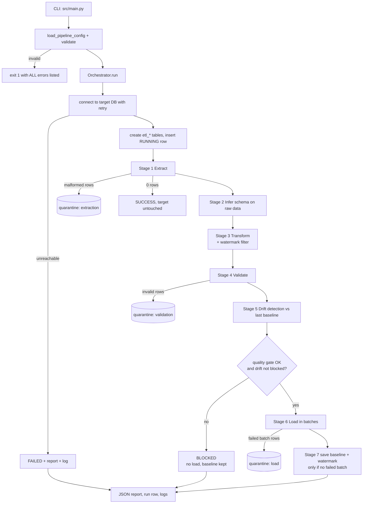

# Configurable ETL Framework with Data Quality Checks - Project Documentation

This document describes what is **actually implemented** in this repository. Where something is not implemented or
not verified, it is listed under [Limitations](#30-limitations).

---

## 1. Project title
**Configurable ETL Framework with Data Quality Checks, Schema Inference and Schema Drift Detection**

## 2. Problem statement
Moving data from files, APIs and databases into a reporting database is usually done with one-off scripts. Those scripts
tend to (a) hard-code each source, (b) load bad rows together with good ones, (c) break or corrupt data when a source
schema changes, (d) leave half-loaded tables after a crash, and (e) leave no audit trail. The goal is a reusable framework
where a new source is a YAML file, bad data is isolated, schema changes are classified and controlled, failures never
corrupt existing data, and each run is auditable.

## 3. Business background
Analytics and operational reporting depend on trustworthy tables. A silent type change (`customer_id` becoming text), a
dropped column, or duplicate primary keys produce wrong dashboards without any error. Teams therefore need ETL that
*detects* such problems and *decides* (by explicit policy) whether loading may continue. The sample domains are
customers (CSV), orders (nested JSON) and products (SQL database); the data is synthetic.

## 4. Why ETL frameworks are required
| Concept | Detail |
|---|---|
| What | A reusable engine plus per-pipeline configuration, instead of one script per dataset. |
| Why | Consistency (every pipeline gets the same checks, logging, retries), speed of adding sources, auditability. |
| Where | `src/pipeline/orchestrator.py` (engine) + `config/pipelines/*.yaml` (behaviour). |
| How | The orchestrator reads a validated config and calls extractor → schema inference → transformer → validator → drift detector → loader; no pipeline-specific code exists in the engine. |
| Problem solved | Copy-paste scripts diverging, inconsistent data quality, no recovery story. |

## 5. Project objectives
1. Extract from CSV, JSON, REST API and SQL sources. 2. Infer schemas. 3. Apply configurable transformations.
4. Validate data quality at the right stage. 5. Detect and govern schema drift. 6. Load reliably into MySQL (full, incremental, append, upsert, batched).
7. Quarantine invalid records without losing valid ones. 8. Recover from transient failures safely. 9. Produce logs, reports and audit tables.

## 6. Project scope
**In scope:** the 12 technologies listed in the brief, three sample pipelines, a CLI, pytest suite, generated DDL.
**Out of scope (deliberately):** web UI/dashboards, schedulers (Airflow/cron integration), distributed processing, cloud services,
ML, streaming, authentication flows beyond a bearer token read from an environment variable.

## 7. Functional requirements
| ID | Requirement | Implemented in |
|---|---|---|
| F1 | Pipelines defined only by YAML, validated before run | `src/config_loader.py` |
| F2 | CSV / JSON / API / SQL extraction | `src/extractors/` |
| F3 | Extraction timestamp, source metadata, row counts | `BaseExtractor.extract` |
| F4 | Schema inference + versioned storage | `src/schema/schema_inference.py`, `schema_store.py` |
| F5 | Config-controlled transformations | `src/transformations/transformer.py` |
| F6 | 10 kinds of data-quality check + per-check result | `src/quality/` |
| F7 | Valid/invalid separation + quarantine | `validator.py`, `src/pipeline/quarantine.py` |
| F8 | Drift detection, classification, policies | `src/schema/drift_detector.py` |
| F9 | Full / append / upsert / incremental, batched | `src/loaders/mysql_loader.py` |
| F10 | Retries, partial loads, batch tracking | `src/utils/retry.py`, loader, `etl_batch_log` |
| F11 | Execution report + logs | `src/monitoring/` |

## 8. Non-functional requirements
Correctness over speed; modular code (extraction ≠ transformation ≠ validation ≠ loading); no secrets in code/YAML;
idempotent re-runs; explainability (every rejected row carries a reason); testability (SQLite stand-in; mocked HTTP);
no unnecessary dependencies.

## 9. Dataset details
**All data is synthetic**, generated deterministically (`random.seed(42)`) by `scripts/generate_sample_data.py`.
Defects are injected on purpose so the checks have something to find.

| Dataset | Source type | File / object | Deliberate defects |
|---|---|---|---|
| Customers | CSV | `data/raw/customers.csv` (120 rows + 2 duplicates + 1 malformed line) | whitespace, mixed-case country/email, blank phone/age/tier, 2 invalid emails, age 17 and 140, blank required name, future signup date, unparsable date, exact duplicate row, duplicate primary key, a row with too many fields |
| Orders | JSON (nested under `orders`) | `data/raw/orders.json` (300 + 1 duplicate) | unknown customer id, quantity 0, negative price, missing `quantity` field, unparsable date, nested `shipping` / `payment` objects |
| Products | SQL | SQLite `data/raw/source.db` table `products` (90 rows, ~10% inactive) | negative price, bad supplier e-mail, null stock |

Schema-drift variants of the customers file: `python scripts/generate_sample_data.py --drift added|removed|type_change`.

## 10. Data dictionary
**customers** (after standardisation)
| Column | Type | Notes |
|---|---|---|
| customer_id | BIGINT, PK | integer |
| customer_name | VARCHAR(255) | required, title-cased |
| email | VARCHAR(255) | required, lower-cased, format-checked |
| phone | VARCHAR(255) | nullable |
| age | BIGINT | nullable, 18-100 |
| country | VARCHAR(255) | upper-cased |
| signup_date | DATE | 2015-01-01 .. today |
| loyalty_tier | VARCHAR(255) | default `standard` when missing |

**orders** (JSON flattened with `_`): `order_id` (PK), `customer_id` (FK-style check against `customers`), `order_date` (watermark), `status`, `quantity` (1-100), `unit_price` (>= 0.01), `shipping_city`, `shipping_country`, `payment_method`.

**products**: `product_id` (PK), `product_name`, `category`, `price` (0.01-100000), `stock_qty` (>= 0; missing → median), `supplier_email`, `last_updated`.

Column types are chosen by the loader when it creates a table (int → BIGINT, float → FLOAT, bool → BOOLEAN, datetime → DATETIME, `date_columns` → DATE, text → VARCHAR(255) or TEXT if longer).

## 11. Technologies used
Python 3.12 (developed/tested), Pandas, NumPy, SQLAlchemy 2.x, MySQL, Requests, PyYAML, `logging`, Pytest, JSON.
**One addition:** `PyMySQL`, the DBAPI driver SQLAlchemy needs in order to talk to MySQL (not an extra technology, a required driver).

## 12. Why each technology was selected
| Technology | Why |
|---|---|
| Python | Standard data-engineering language; rich ecosystem. |
| Pandas | Vectorised cleaning/validation of tabular batches; `json_normalize` for nested JSON. |
| NumPy | NaN handling and numeric operations underneath Pandas (`np.nan` as the null marker in transforms). |
| SQLAlchemy | One API for MySQL (target) and SQLite (tests, sample source); dialect-specific upsert; reflection; bound parameters. |
| MySQL | Required target; InnoDB transactions give per-batch atomicity. |
| Requests | Simple, well-tested HTTP with timeouts. |
| PyYAML | Human-readable configuration (`safe_load` only). |
| logging | Standard, handler-based, per-run files. |
| Pytest | Fixtures (tmp DBs, settings), parametrisation, monkeypatching for failure injection. |
| JSON | Schema metadata, drift and execution reports. |

## 13. ETL architecture

Pipeline statuses: `SUCCESS`, `PARTIAL_SUCCESS`, `BLOCKED`, `FAILED`.

## 14. Extraction methodology
| | |
|---|---|
| What | Reading source data into a DataFrame plus metadata (`source_type`, `extracted_at`, `row_count`, `column_count`, `rejected_count`, path/url/query). |
| Why | Isolates source-specific code so the rest of the pipeline sees one shape. |
| Where | `src/extractors/*.py`; factory `build_extractor` in `src/extractors/__init__.py`. |
| How | `BaseExtractor.extract()` timestamps the call, runs `_extract()`, resets the index, builds metadata. |
| Problem solved | Adding a source = one class + registry entry; the engine is untouched. |

- **CSV:** read with the `csv` module; everything stays text (types are inferred later). Rows whose field count differs from the header are *rejected* (kept in `rejected`, later quarantined). Empty fields and `NA/N/A/n/a/NULL/null/NaN/nan/#N/A` become nulls. Empty file (no header) → `ExtractionError`; header-only → empty frame.
- **JSON:** `record_path` (dotted) selects the list; nested dicts are flattened (`shipping.city` → `shipping_city`); leftover lists become JSON text; missing fields become nulls; non-object items are rejected; JSON-Lines supported (bad lines rejected); malformed JSON → `ExtractionError`.
- **API:** `requests.Session`, configurable timeout (default 10 s), retries with exponential backoff for timeouts, connection errors, HTTP 5xx and 429; other 4xx fail immediately; response must be valid JSON and a list of objects (`data_key` optional). Pagination: `page`, `offset`, `link` (follow a `next` URL). If `max_pages` is hit the run **fails** rather than continue with possibly truncated data. Tokens are read from environment variables (`auth.token_env`, `${VAR}` in headers/params).
- **SQL:** the connection URL comes from the environment variable named in `connection_env`; only a single `SELECT`/`WITH` statement is accepted (validated in config *and* at runtime); `params` are bound parameters; transient DB errors are retried.

## 15. Transformation methodology
| | |
|---|---|
| What | Reusable, config-controlled cleaning steps. |
| Why | Raw data must be made consistent before it can be validated and loaded. |
| Where | `src/transformations/transformer.py` (no validation or DB code). |
| How | Fixed order: standardise columns → trim → type/date conversion → missing values → case normalisation → de-duplication. Config column names refer to names *after* standardisation. |
| Problem solved | Duplicated cleaning code; silent data loss. |

- **Column standardisation:** `Customer ID`, `customerId`, ` E-mail ` → `customer_id`, `customer_id`, `e_mail`; collisions get `_2`, `_3` so no column is overwritten.
- **Trimming:** strips strings; blank/whitespace-only → null.
- **Type conversion** (`integer`, `float`, `string`, `boolean`, `date`, `datetime`): values that cannot be converted become null **and are recorded per row** (`conversion_failures`), so the validator quarantines those rows with the reason instead of losing the information.
- **Date standardisation:** mixed formats parsed (`format="mixed"`, optional `date_dayfirst`), timezone-aware values converted to UTC then made naive, `date` columns normalised to midnight.
- **Missing values:** `fill: {col: value}` and `strategies: {col: mean|median|mode}`. Rows are never dropped for nulls (that is the validator's job).
- **Normalisation:** `lowercase`, `uppercase`, `titlecase` lists. (Numeric scaling is intentionally not applied: it would alter business values.)
- **De-duplication:** exact duplicates, or by `subset`/`keep`; the number removed is reported (`transform_stats.duplicates_removed`) and logged.

## 16. Data quality checks
| | |
|---|---|
| What | Rules a dataset must satisfy. Every check returns `check_name`, `level`, `total_checked`, `passed`, `failed`, `failure_pct`, `error_details` (capped, default 20), `unit`, `status`. |
| Why | Keep bad data out of reporting tables, and explain why. |
| Where | `src/quality/quality_checks.py` (checks) and `validator.py` (orchestration, valid/invalid split). |
| How | Row-level checks produce `{row_index: reason}`; the validator unions them, splits the frame into `valid` and `invalid` (+ `_dq_reasons`). Dataset-level checks decide a **quality gate**. |
| Problem solved | Bad rows contaminating good data; opaque rejections. |

| # | Check (`quality_checks.*`) | Level | Behaviour |
|---|---|---|---|
| 1 | Null check on `required_columns` (+ primary key) | row | row quarantined if any required value is null |
| 2 | Null threshold (`null_threshold`, `null_threshold_columns`, `null_threshold_action`) | dataset (unit = columns) | column null ratio above threshold → gate fails (`fail`) or warning (`warn`) |
| 3 | Duplicate rows (`check_duplicates`) | row | later exact duplicates quarantined |
| 4 | Primary-key uniqueness (`primary_key_policy`: `keep_first`/`keep_last`/`quarantine_all`) | row | extra occurrences quarantined; null keys left to check 1 |
| 5 | Data types (`column_types` + transformer conversion failures) | row | invalid / unconvertible values quarantined |
| 6 | Required columns present | dataset (unit = columns) | missing column → gate fails |
| 7 | Range (`range_checks`) | row | outside min/max or non-numeric |
| 8 | Email format (`email_columns`) | row | regex check; nulls ignored (check 1 handles them) |
| 9 | Date validation (`date_checks`, `min`/`max`, `today`) | row | unparsable or out of range |
| 10 | Referential integrity (`referential_checks`) | row | value absent from `reference_table.reference_column` in the target DB; missing reference table **fails the run** |
| 11 | Custom rules (`custom_rules`: pandas `eval` expressions) | row | rows where the expression is false/NA; an expression that cannot be evaluated fails the gate |

A check on a column that does not exist is reported as a dataset-level failure (gate), not a crash. For dataset-level checks the
"records" fields count *columns/rules* (see the `unit` field), which is stated explicitly in each result.

## 17. Schema inference
| | |
|---|---|
| What | Automatically determining column names, logical types, nullability, uniqueness, and statistics. |
| Why | Needed to detect drift and to know what the source actually looks like. |
| Where | `src/schema/schema_inference.py` (`infer_schema`), persisted by `schema_store.py` and `MetadataRepository`. |
| How | Typed columns use their dtype. Text columns are inspected value by value with regexes: integer (no leading zeros), float, boolean (`true`/`false`), datetime (ISO, `d/m/Y`, `d-m-Y`, verified by parsing), else string. All-null → `unknown`. |
| Problem solved | CSV is all text; JSON/SQL types vary; a baseline is required for drift detection. |

Per column: `position`, `type`, `nullable`, `null_count`, `null_pct`, `unique`, `distinct_count`, `stats` (numeric min/max/mean, datetime min/max, string min/max length, boolean true count).
Inference runs on the data **as extracted** (before transformation), so drift is about the *source's* schema. Versions are saved to
`schemas/<pipeline>/schema_v0001.json, ...` and mirrored to `etl_schema_metadata`. A version is written on the first successful run and whenever
an accepted change occurs - not on every run.

## 18. Schema drift detection
| | |
|---|---|
| What | Comparing the current inferred schema with the last accepted one. |
| Why | Source schemas change without warning; silent acceptance corrupts targets. |
| Where | `src/schema/drift_detector.py`; applied in the orchestrator (Stage 5); policies in `schema_drift.policies`. |
| How | Column sets and per-column `type`/`nullable` are diffed; each change gets a severity and a policy action. |
| Problem solved | Critical changes can no longer be loaded unnoticed. |

| Change | Severity | Policy key | Default | Effect on loading |
|---|---|---|---|---|
| Column added | WARNING | `column_added` | `exclude` | `exclude`: load proceeds without the new column · `add`: `ALTER TABLE ... ADD COLUMN` (nullable) then load · `block`: nothing loaded |
| Column removed | CRITICAL | `column_removed` | `block` | `block`: nothing loaded · `allow`: load proceeds (missing column loads as NULL) |
| Type changed, incompatible (e.g. integer→string) | CRITICAL | `type_changed` | `block` | as above |
| Type integer→float | WARNING | - | always allowed | load proceeds |
| Type float→integer | INFO | - | always allowed | load proceeds |
| Became nullable | WARNING | `nullable_changed` | `allow` | `block` available |
| No longer nullable | INFO | - | always allowed | load proceeds |

Overall `schema_drift_status` is the highest severity (`NONE`, `INFORMATIONAL`, `WARNING`, `CRITICAL`) or `BASELINE_CREATED` on the first run.
When a load is **blocked**, the run ends `BLOCKED`, the baseline is **not** updated, and a drift report is saved
(`schemas/<pipeline>/drift_reports/`, `etl_schema_drift_history`). A reviewed change can be accepted with `--accept-drift`: blocking policies become
`allow` (a blocked *new column* becomes `add`) and the new schema becomes the next version.
Columns excluded by policy are deliberately **not** written into the baseline, so they keep being reported until someone decides (`add` them or fix the source).

**Example** (spec example, covered by `tests/test_schema.py::test_new_column_example_from_spec_is_detected_and_excluded`):
```
previous: customer_id integer, customer_name string, email string
current : customer_id integer, customer_name string, email string, phone string
→ change: column_added 'phone' (WARNING), action=exclude, status=WARNING, decision=proceed
→ the row data is loaded WITHOUT phone; report lists the exclusion; phone is reported again on the next run.
```
Using the sample data: `--drift added` → WARNING, loaded without the new column; `--drift removed` (drops `Phone`) → CRITICAL, `BLOCKED`, exit code 3;
`--drift type_change` (`Customer ID` becomes `CUST-0001`) → CRITICAL type change, `BLOCKED`.

## 19. Database design
Business tables are created from the data on first load, with the configured primary key. Pipeline metadata lives in separate `etl_`-prefixed tables
(business tables may not use that prefix - enforced by config validation). DDL: `sql/schema_mysql.sql` (generated from `src/db/models.py`).

| Table | Purpose | Keys / indexes |
|---|---|---|
| `etl_pipeline_runs` | one row per run (status, counts, drift status, error, full report JSON) | PK `execution_id`; index (`pipeline_name`,`start_time`), `status` |
| `etl_data_quality_results` | every check result per run | PK `id`; FK → runs; index `execution_id`, (`check_name`,`status`) |
| `etl_schema_metadata` | schema versions | PK `id`; UNIQUE (`pipeline_name`,`version`) |
| `etl_schema_drift_history` | drift reports | PK `id`; index (`pipeline_name`,`created_at`) |
| `etl_quarantined_records` | rejected records + reason (stage = extraction / validation / load) | PK `id`; FK → runs; index `execution_id`, (`pipeline_name`,`stage`) |
| `etl_batch_log` | per-batch status and attempts | PK `id`; FK → runs; UNIQUE (`execution_id`,`batch_number`) |
| `etl_watermarks` | last incremental watermark per pipeline | PK `pipeline_name` |

Example monitoring queries: `sql/monitoring_queries.sql`.

## 20. Loading strategies
| | |
|---|---|
| What | Writing validated rows to MySQL in batches. |
| Why | Reliability, bounded transaction size, idempotency. |
| Where | `src/loaders/mysql_loader.py`. |
| How | See table. |
| Problem solved | Partial/duplicate/corrupt loads. |

| Mode | Behaviour |
|---|---|
| `full` | Rows are staged in `<table>__stg_<id>`; only if **every** batch staged is the target replaced (`DELETE` + `INSERT ... SELECT` in **one transaction**). Failure → staging dropped, existing data untouched. An empty source never wipes the target. |
| `append` | `on_duplicate: skip` (default) → duplicate keys are ignored without error (MySQL: no-op `ON DUPLICATE KEY UPDATE`, **not** `INSERT IGNORE`, which would also hide NOT NULL/truncation errors); `update` → upsert; `error` → plain insert, duplicates fail the batch. |
| `upsert` | MySQL `INSERT ... ON DUPLICATE KEY UPDATE` (SQLite: `ON CONFLICT DO UPDATE`). Requires a primary key. |
| incremental | `load.watermark_column`: after transformation only rows with value `>=` the stored watermark are processed (`>=` so boundary rows are never missed; idempotent writes make re-reading safe). Rows with a null watermark value are kept (and validated). The watermark advances only after a run with **no failed batch**. Not allowed with `full`. |

Existing target tables are never altered silently: unexpected columns raise `SchemaMismatchError` unless the drift policy approved `add`; the
configured primary key must match the table's primary key.

## 21. Partial loading and recovery
- append/upsert: **each batch is its own transaction**; the `etl_batch_log` row is written in the same transaction as the data, so the log can never disagree with the data.
- A failed batch is rolled back alone; earlier batches stay committed; later batches still run. Failed rows are written to quarantine (stage `load`) with the error, and the run ends `PARTIAL_SUCCESS`.
- Retries re-run a batch as a fresh transaction; because upsert/skip are idempotent on the primary key, a retry cannot create duplicates.
- `full` mode is intentionally all-or-nothing (see above); a failed full load ends `FAILED` and `etl_batch_log` rows are marked `ROLLED_BACK`.
- After `PARTIAL_SUCCESS` the baseline schema and watermark are **not** advanced, so a re-run re-processes the same window safely.

## 22. Error handling
| Situation | Behaviour |
|---|---|
| Invalid configuration | exit code 1, every error listed, nothing runs |
| Source missing / malformed / API failure | `ExtractionError` → run `FAILED`, report + log written |
| API timeout / 5xx / 429 / connection error | retried (backoff), then `ExtractionError` |
| Database unreachable | retried, then run `FAILED` (report/log still written) |
| Transient DB error in a batch | retried; integrity/data errors are **not** retried |
| Bad rows | quarantined with reason (CSV file + DB table) |
| Quality gate / critical drift | `BLOCKED`, nothing loaded |
| Unexpected exception | caught at the top level → `FAILED`, stack trace in the log |

Retry parameters (`max_attempts`, `backoff_seconds`, `backoff_factor`) come from `config/settings.yaml` and can be overridden per pipeline.

## 23. Logging and monitoring
- `src/monitoring/logger.py`: one log file per run `logs/<pipeline>_<execution8>.log` (+ console); each line carries timestamp, level, pipeline and execution id.
- `src/monitoring/report_generator.py`: `reports/<pipeline>_<execution8>.json` with pipeline name, execution id, start/end time, duration, source type, extracted / transformed / valid / invalid / loaded counts, failed batch count, schema drift status, overall status, plus quality results, drift details, batches, warnings and artifact paths. Sample: `docs/sample_execution_report.json`.
- Counting rules: `extracted` = rows parsed (excludes malformed CSV rows); `transformed` = rows after de-duplication and watermark filtering; `invalid` = validation failures + extraction rejects + rows from failed load batches; `loaded` = rows in **successfully committed** batches (with append/skip, rows skipped as duplicates are still counted as processed).
- The same information is queryable from the `etl_*` tables.

## 24. Testing strategy
`pytest` (124 tests) - executed in the development sandbox and all passed. Layers:

| File | Covers |
|---|---|
| `test_config.py` | config validation (unknown keys, bad values, multiple errors, upsert/incremental rules, missing/invalid YAML, CLI) |
| `test_extractors.py` | CSV (malformed rows, empty file, header-only, delimiter), JSON (nesting, malformed, JSON-Lines, empty), API (pagination, timeouts, retries, 4xx/5xx, bad JSON, truncation guard, auth env - **mocked HTTP only**), SQL (bound params, empty, non-SELECT, missing env, SQL failure) |
| `test_transformer.py` | each transformation, conversion failures, dedupe interplay, empty frames, no mutation |
| `test_quality.py` | every check, valid/invalid partition, result contract, gates, referential integrity, empty data |
| `test_schema.py` | inference (text/typed/empty), store versioning, every drift type/policy/override |
| `test_loader.py` | table creation, batches, upsert/append/full, **partial load**, **retry behaviour** (transient success, exhausted, non-retried integrity errors), atomic full load, schema mismatch, batch log |
| `test_pipeline.py` | end-to-end runs: metadata tables, idempotent re-run, drift block / accept / add / exclude, quality gates, empty source, source/DB failure reports, partial load, incremental watermark |
| `test_mysql_sql_generation.py` | the MySQL SQL we emit (upsert, no-op skip, DDL) is generated correctly - compilation only |

**Honest scope:** tests run against SQLite. They do **not** execute against a live MySQL server or a real HTTP API.

## 25. Complete end-to-end workflow
1. `python -m src.main --pipeline config/pipelines/customers.yaml`.
2. `.env` is read (existing environment wins); settings + pipeline YAML merged and validated.
3. Engine built from `ETL_TARGET_URL` or `MYSQL_*`; connectivity checked with retries; `etl_*` tables created; a `RUNNING` row inserted.
4. **Extract** → malformed rows to quarantine.
5. **Infer** schema of the raw data.
6. **Transform** (+ watermark filter).
7. **Validate** → results saved to `etl_data_quality_results`; invalid rows quarantined.
8. **Drift** vs. last baseline → drift report saved when anything changed.
9. If a gate failed or drift is blocking → `BLOCKED`, go to 12.
10. **Load** valid rows (excluded columns dropped, approved columns added) in batches; failed batch rows quarantined.
11. If no batch failed: save new schema version (if accepted changes) and advance the watermark.
12. Write JSON report, update `etl_pipeline_runs`, print summary, exit code (0/1/2/3).

## 26. Folder structure explanation
```
config/settings.yaml              global paths, logging, retry/batch defaults
config/pipelines/*.yaml           one file per pipeline (this is how sources are added)
data/raw|processed|quarantine     inputs | valid rows that were submitted for load | rejected records
src/config_loader.py              YAML loading + validation + defaults
src/exceptions.py                 framework error types
src/extractors/                   base + csv/json/api/sql extractors + factory
src/transformations/transformer.py
src/quality/                      quality_checks.py (rules) + validator.py (orchestration)
src/schema/                       schema_inference.py, schema_store.py, drift_detector.py
src/loaders/mysql_loader.py       batch loading, full/append/upsert, retries
src/db/                           connection.py, models.py (etl_* tables), repository.py (all metadata SQL)
src/pipeline/                     orchestrator.py, quarantine.py
src/monitoring/                   logger.py, report_generator.py
src/utils/                        retry, env, paths, time helpers
src/main.py                       CLI
schemas/ reports/ logs/           generated artefacts (git-ignored)
sql/                              schema_mysql.sql (generated), monitoring_queries.sql
scripts/                          synthetic data generator, DDL exporter
tests/                            pytest suite
```
Small additions to the suggested layout, each justified: `src/db/` (keeps SQL out of the orchestrator), `src/utils/`, `src/pipeline/quarantine.py`, `src/config_loader.py`, `scripts/`.

## 27. Installation instructions
```bash
python -m venv .venv && source .venv/bin/activate
pip install -r requirements.txt
cp .env.example .env     # edit; keep out of version control
```
MySQL: create an empty database and a user with `CREATE, ALTER, INSERT, UPDATE, DELETE, SELECT, DROP, INDEX` rights on it (DROP/ALTER are needed for staging tables and approved column additions).
Credentials are supplied only via environment variables (`ETL_TARGET_URL` or `MYSQL_HOST/PORT/USER/PASSWORD/DATABASE`; source DB via `SOURCE_DB_URL`).

## 28. Execution instructions
```bash
python scripts/generate_sample_data.py             # synthetic inputs (+ --drift added|removed|type_change)
python -m src.main --all --validate-config
python -m src.main --all                           # alphabetical: customers, orders, products (orders needs customers loaded first)
python -m src.main --pipeline config/pipelines/orders.yaml --set load.batch_size=50
python -m src.main --pipeline config/pipelines/customers.yaml --set source.path=data/raw/customers_drift_removed.csv --accept-drift
pytest
```
`--set key=value` overrides any dotted pipeline setting for one run (values are strings; keep that in mind for numbers/booleans - the config validator will reject a wrong type).

## 29. Expected outputs
For the synthetic data on a clean database (observed in a SQLite run in the development sandbox):

| Pipeline | extracted | transformed | valid | invalid | loaded |
|---|---|---|---|---|---|
| customer_etl | 122 | 121 | 113 | 9 | 113 |
| order_etl | 301 | 300 | 278 | 22 | 278 |
| product_etl | 81 | 81 | 79 | 2 | 79 |

(Customers: 1 malformed line was rejected at extraction and is counted separately in the quarantine file; 1 exact duplicate was removed by the transformer.)
A second run of `order_etl` skips already-seen rows via the watermark. Outputs: reports in `reports/`, quarantine CSVs in `data/quarantine/`, schemas in `schemas/<pipeline>/`, logs in `logs/`, loaded data and `etl_*` tables in the database.

## 30. Limitations
- **Not validated on a live MySQL server.** Execution and tests used SQLite; MySQL-specific SQL is only checked by compilation. Expect to confirm behaviour on your MySQL version (e.g. `ON DUPLICATE KEY UPDATE` syntax variants, DDL implicit commits).
- The API extractor was exercised with mocked HTTP only, not a live API.
- Whole sources are processed in memory (single process); not designed for datasets larger than RAM.
- Inference runs on raw values: one stray non-numeric value turns an otherwise numeric column into `string`, which is reported as a (critical) type change. Nullability is data-dependent and can flap between runs.
- Records quarantined earlier are **not** automatically re-processed; with a watermark, a fixed upstream row older than the watermark will not be picked up again (there is no replay command yet).
- `custom_rules` use pandas `eval` on expressions from trusted, version-controlled YAML; do not accept expressions from untrusted users.
- Referential checks read the reference column's distinct values into memory.
- `loaded` counts rows of committed batches, not rows actually changed by the database.
- No cross-run locking: two simultaneous runs of the same pipeline are not prevented.
- Full loads use one large `DELETE + INSERT ... SELECT` transaction (needs transaction/undo capacity).
- pandas datetimes cover roughly years 1677-2262; values outside that range are treated as unparsable.
- Metadata tables share the target database (prefix-separated, not a separate schema).
- Business-table column types are chosen from the first batch's data; later widening is not automatic.
- CLI `--set` values are strings.

## 31. Future improvements
Quarantine replay command; separate metadata schema; locking/lease table for concurrent runs; chunked/streaming extraction;
OAuth/API-key helpers; per-column type widening policies; drift on column order/uniqueness; integration tests against containerised MySQL in CI;
configurable nullability-flap tolerance; richer report formats (CSV summary across runs).
