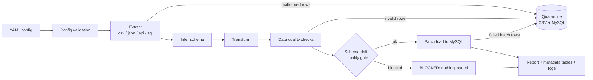

# Configurable ETL Framework with Data Quality Checks

A reusable, configuration-driven ETL framework in Python. It extracts data from CSV, JSON, REST APIs and SQL
databases, infers schemas, transforms, validates data quality, **detects schema drift**, and loads reliable data into
MySQL in safe batches while quarantining bad records instead of losing them.

> All sample data is **synthetic** (generated by `scripts/generate_sample_data.py`). Nothing here is real customer data,
> and the project has not been deployed to production.

**Full documentation:** [docs/PROJECT_DOCUMENTATION.md](docs/PROJECT_DOCUMENTATION.md)

## Problem statement
One-off scripts that copy files into a database break silently: a renamed column, a bad batch, a duplicate key or a
retried run can corrupt reporting tables without anyone noticing. This project shows how to build the same pipeline
as a framework where new sources are *configuration*, bad data is *isolated and explained*, schema changes are
*classified and policy-controlled*, and every run leaves an *auditable record*.

## Key features
- **4 source types** - CSV, JSON (nested, flattened), REST API (pagination, timeouts, retries), SQL `SELECT`.
- **YAML-driven pipelines**, validated before execution (all errors reported at once, unknown keys rejected).
- **Schema inference** (types, nullability, uniqueness, stats) stored as versioned JSON + in MySQL.
- **Reusable transformations** - column standardisation, trimming, type/date conversion, missing values, case normalisation, de-duplication.
- **Data quality engine** - null, duplicate, primary-key, type, required-column, range, email, date, referential-integrity and custom-expression checks, each reporting total / passed / failed / failure % / details.
- **Schema drift detection** with INFO / WARNING / CRITICAL classification and explicit load policies.
- **Safe loading** - full (atomic staged swap), append (idempotent skip), upsert, incremental (watermark), batched transactions.
- **Recovery** - per-batch transactions + retries for transient errors, failed rows quarantined, `PARTIAL_SUCCESS` status.
- **Monitoring** - per-run log file, JSON execution report, run/quality/drift/batch/quarantine tables in MySQL.

## Architecture


## Technology stack
Python, Pandas, NumPy, SQLAlchemy, MySQL (via the PyMySQL driver), Requests, PyYAML, `logging`, Pytest, JSON.
No Spark/Kafka/Airflow/Docker/cloud/ML/web framework.

## ETL workflow
1. **Extract** (retries on timeouts / connection errors) 2. **Infer schema** 3. **Transform** 4. **Validate** (valid vs invalid split)
5. **Drift check** against the last accepted schema 6. **Load** valid rows in batches 7. **Record** report, metadata, quarantine.

## Data quality capabilities
Row-level failures are quarantined with a reason. Dataset-level failures (missing required column, null-threshold breach,
broken custom rule) act as a **quality gate** that stops loading. See docs section 16.

## Schema drift detection
| Change | Severity | Default policy |
|---|---|---|
| New column | WARNING | `exclude` from load (also: `add` to target, or `block`) |
| Removed column | CRITICAL | `block` |
| Incompatible type change | CRITICAL | `block` |
| int → float | WARNING | allow |
| Became nullable | WARNING | allow |

Critical changes are never accepted silently: the load is blocked, the baseline is not updated, and a drift report is
saved. After review, rerun with `--accept-drift`.

## Error handling and recovery
- Transient DB / API errors: retried with exponential backoff; integrity errors are **not** retried.
- append/upsert: each batch is its own transaction, so one bad batch never discards committed ones.
- full load: staged and swapped in one transaction (all-or-nothing; the old data survives any failure).
- Retries are duplicate-safe (idempotent upsert / skip-on-duplicate).
- Unreachable database or source: run ends `FAILED`, a report and log are still written.

## Project structure
```
config/        settings.yaml + pipelines/{customers,orders,products}.yaml
data/          raw/ (synthetic inputs)  processed/  quarantine/
src/           extractors/ transformations/ quality/ schema/ loaders/ pipeline/ monitoring/ db/ utils/ main.py
schemas/       versioned schemas + drift reports (generated)
reports/ logs/ generated per run
sql/           schema_mysql.sql (generated DDL), monitoring_queries.sql
scripts/       generate_sample_data.py, export_ddl.py
tests/         pytest suite
docs/          PROJECT_DOCUMENTATION.md, sample_execution_report.json
```

## Installation
```bash
python -m venv .venv && source .venv/bin/activate      # Windows: .venv\Scripts\activate
pip install -r requirements.txt
cp .env.example .env                                   # then fill in MySQL credentials (never commit .env)
python scripts/generate_sample_data.py                 # synthetic data
```
Create the MySQL database/user yourself, e.g. `CREATE DATABASE etl_db CHARACTER SET utf8mb4;` - the framework creates all tables.

## Execution
```bash
python -m src.main --all --validate-config                       # validate every pipeline config
python -m src.main --pipeline config/pipelines/customers.yaml     # run one pipeline
python -m src.main --all                                          # customers -> orders -> products
# schema-drift demo
python scripts/generate_sample_data.py --drift removed
python -m src.main --pipeline config/pipelines/customers.yaml --set source.path=data/raw/customers_drift_removed.csv
python -m src.main --pipeline config/pipelines/customers.yaml --set source.path=data/raw/customers_drift_removed.csv --accept-drift
```
Exit codes: `0` success, `1` failed/invalid config, `2` partial success, `3` blocked.
No MySQL handy? Point `ETL_TARGET_URL` at a SQLite file (`sqlite:///demo.db`) for a local trial.

## Testing
```bash
pytest
```
The suite (124 tests) ran green in the development sandbox against **SQLite** as a stand-in for MySQL. MySQL-specific SQL
(upsert, DDL) is verified by compilation tests only; it has **not** been run against a live MySQL server - see
*Limitations* in the documentation.

## Sample execution report
Real output from the synthetic customers CSV (full file: [docs/sample_execution_report.json](docs/sample_execution_report.json)):
```json
{
  "pipeline_name": "customer_etl", "source_type": "csv", "status": "SUCCESS",
  "counts": {"extracted": 122, "transformed": 121, "valid": 113, "invalid": 9, "loaded": 113, "failed_batches": 0},
  "schema_drift_status": "BASELINE_CREATED",
  "duration_seconds": 0.125
}
```
(The duration is for a tiny local SQLite run and says nothing about production performance.)
